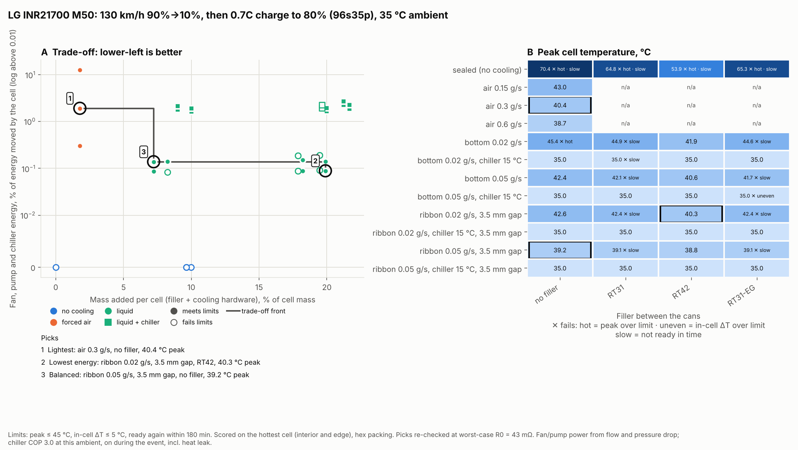
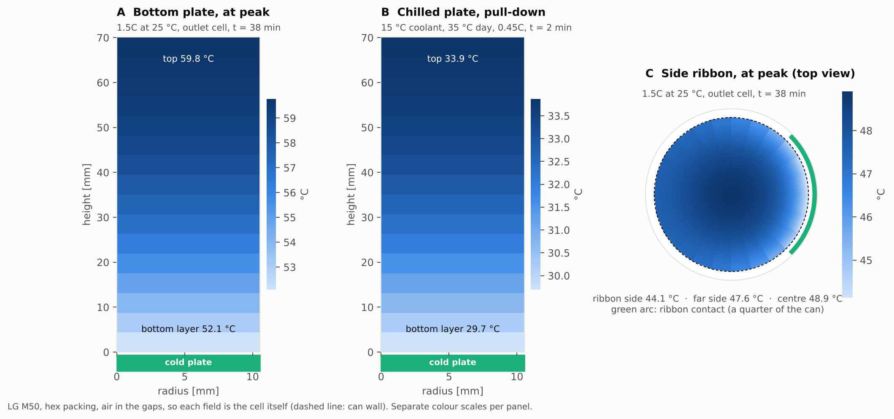
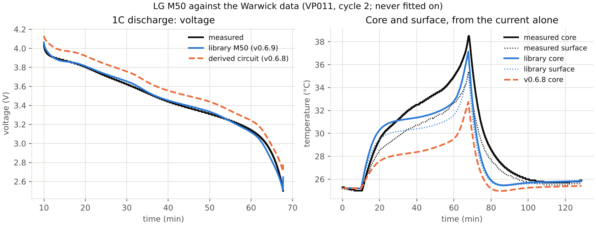

# PackTherm: battery thermal management design toolkit

PackTherm designs the cooling for a pack of cylindrical cells. Give it a cell, a duty cycle and your limits. It simulates every combination of cooling layout, coolant flow, chiller and gap filler (none, phase-change material or graphite composite) inside a packed module. Then it shows the trade-off between **mass added** and **fan, pump and chiller energy**, and picks the lightest, the most efficient and a balanced design that still pass when the cells' resistance is at its worst case.

It answers questions like *"for this cell and this duty, should I use air, a cold plate or a side ribbon, at what flow, and is PCM worth its weight?"* The cell model is validated against 48 blind tests on a commercial cell from 25 °C down to −20 °C. PackTherm started as an MSc thesis model in MATLAB; how it got here is in [docs/HISTORY.md](docs/HISTORY.md).

**Try it in your browser: [omlettehead22.github.io/PackTherm](https://omlettehead22.github.io/PackTherm/).** Nothing to install: PackTherm runs on your own computer, inside the page, so nothing you enter is sent anywhere.


## Design result: LG M50 pack on a hot road trip

```bash
packtherm design M50 --duty roadtrip --t-env 35 --out-dir results/
```

An LG M50 21700 pack (61 kWh, 96s35p) in a C-segment EV drives at 130 km/h from 90 % to 10 % charge on a 35 °C day, then rapid-charges at 0.7C to 80 %. Limits: peak 45 °C, 5 K inside the cell, ready again (back near ambient, PCM re-frozen) within 3 hours. **39 designs, 24 feasible** ([CSV](docs/examples/module_m50_roadtrip_130kmh_35c_designs.csv)):

| Pick | Design | Hottest cell | Mass added | Fan, pump and chiller energy |
|---|---|---|---|---|
| Lightest | forced air, 0.3 g/s per cell | 40.4 °C | +1.8 % | 1.91 % of the energy moved |
| Lowest energy | side ribbon, 0.02 g/s per cell, 3.5 mm gap, RT42 | 40.3 °C | +19.9 % | 0.09 % |
| Balanced | side ribbon, 0.05 g/s per cell, 3.5 mm gap | 39.2 °C | +7.2 % | 0.14 % |



**What it shows**
- **Liquid cooling costs very little to run.** About 0.1 % of the energy moved, mostly the radiator fan (the pump itself is under a fifth), against 1.9 % for the air design that passes. Air at half that flow (0.3 % of the energy) is feasible but fails the worst-case resistance check (45.6 °C), and the lightest cold plate (0.02 g/s) now runs over the limit (45.4 °C). The real choice is hardware mass against fan energy.
- **A PCM that melts below ambient is a liability.** At 35 °C, RT31 (melting at 31 °C) never re-freezes, so every RT31 design without a chiller fails on recovery. RT42 still works.
- **A chiller holds every cell at 35 °C** but costs 1.6–2.8 % of the energy moved, about 20–30 times the cheapest liquid design without one. Its COP falls with ambient (about 3.0 at 35 °C), and heat leaking in from the hot day is charged to it.
- **An uncooled pack reaches 70 °C.** Inside a pack, an interior cell has nowhere to shed heat, so "natural cooling" does not exist.

The same study on three back-to-back WLTC cycles ([chart](docs/examples/module_m50_wltc3_35c_tradeoff.png)) keeps every cooled design within 1.2 K of the 35 °C ambient, and even a sealed pack peaks at 38 °C: a 61 kWh pack sees mild C-rates on urban driving. **Thermal design is driven by motorway driving and rapid charging.**

### Inside the cell: why the 2D models matter

A cold plate under the cell or a ribbon on one side cools the cell unevenly, so those designs are solved on 2D slices of the cell's share ([how](docs/figures/model_overview.svg)). At 1.5C the plate-cooled cell runs about 8 K hotter at the top than at the base. The same plate pulling a hot-soaked pack down to a 15 °C chiller opens a large gradient while it does so, which is why some chilled plate designs fail on unevenness.



### Cooling layouts compared

```bash
packtherm module M50 --compare --c-rate 1.5
```

LG M50 at a 1.5C full discharge, 25 °C, hex packing, 0.05 g/s coolant per cell ([CSV](docs/examples/m50_module_1.5c_25c.csv)); the inlet cell is the first on the coolant channel and the outlet cell the last:

| Cooling | Filler | Inlet cell peak | Outlet cell peak | Cell-to-cell | Inside the cell | Pump / fan per cell |
|---|---|---|---|---|---|---|
| none | air | 91.0 °C | 91.0 °C | 0 K | 0 K | 0 |
| forced air, 2 mm gap | air | 48.4 °C | 53.3 °C | 4.9 K | 2.2 K | 169 mW |
| bottom plate | air | 53.0 °C | 59.8 °C | 6.8 K | **8.2 K** | 4.7 mW |
| bottom plate | RT42-EG | 45.3 °C | 52.1 °C | 6.8 K | 9.9 K | 4.7 mW |
| side ribbon, 3.5 mm gap | air | **35.9 °C** | 48.8 °C | 13.0 K | 4.9 K | 4.7 mW |
| side ribbon, 3.5 mm gap | RT31 | 34.8 °C | **45.6 °C** | 10.8 K | 4.7 K | 4.7 mW |

At the M50's rated 1.5C, run continuously to empty, every one of these cells passes 45 °C somewhere (the cell's resistance measured in v0.6.9 doubled its heat), and the design study on this duty finds no feasible design ([results](docs/examples/module_m50_discharge_1.5c_25c_designs.csv)). The comparisons still hold:

- **Side ribbon vs bottom plate for a 70 mm cell:** the ribbon runs about 17 K cooler at the inlet while touching a quarter of the can, and its in-cell spread is 4.9 K against 8.2 K. Pulling heat down the full height of the winding is slow, and since v0.6.12 the plate's coolant side is worked out from its channels: a 10 × 4 mm channel under half the footprint gives about 650 W/m²K per can base, where the ribbon's many small ports give about 1,950 per bonded strip (both had been an assumed 1,500). That is why tall cylindrical cells are usually side-cooled.
- **The coolant warms up to 17 K along the channel** at this flow, so the outlet cell runs up to 13 K hotter than the inlet cell. PCM in the gaps narrows that spread (13.0 → 10.8 K with RT31, 8.4 K with RT42-EG).
- **More flow mostly cuts how much the coolant warms:** the channels are laminar, so extra flow barely improves heat transfer at the can. On the road trip, 2.5 times the flow lowers the hottest cell by about 3 K for about 1.6 times the pump and fan energy.

## Validation

**Measured cell (Panasonic NCR18650PF):** 48 blind tests (drive cycles, 1C discharge, CC-CV charge) at chamber temperatures from 25 °C to −20 °C, from the open Kollmeyer dataset (CC BY 4.0). One parameter, the chamber's heat-transfer coefficient, is calibrated on one further test.
- **Fully predictive** (current in, voltage and temperature out): median surface-temperature error **0.65 K RMSE**, with 88 % of tests within 1 K. Voltage error is 17–34 mV from 25 °C to 0 °C and 53–70 mV at −10 and −20 °C.
- **Thermal model alone** (measured heat in): **0.60 K** median, 96 % within 1 K, including 20 K self-heating rises at −20 °C.


**Fitted cell (LG INR18650-HG2):** 74 tests it never saw, from current alone: 36.6 mV median voltage error and 93% within 1 K (v0.6.8 fixed a bug that had kept most of its cold drive cycles out of the fit; the median is unchanged). Blind in v0.6.4 it was 59.7 mV; v0.6.5 fixed what that showed (see [docs/FITTING.md](docs/FITTING.md#a-third-cell-fitted-blind-the-lg-hg2)).

**Fitted LFP cell (A123 ANR26650M1B), blind (v0.6.6):** fitted at seven temperatures with no pulse tests (the kinetics from its drive profiles). From 5 to 45 °C its profiles fit to 4–7 mV, and a 25 °C profile at four times the current, never fitted to, comes out at 8.2 mV. At −12 °C it fails (about 100 mV): the cell runs out well before the model. A C/30 charge ran 35–50 mV above it: LFP's hysteresis, modelled from v0.6.7. Refitted with its slow charges, a held-out charge comes within 7.5 mV (was 41.2), and with the hysteresis in two parts (v0.6.8) its warm discharge profiles are back to 4–7 mV (see [docs/FITTING.md](docs/FITTING.md#fixes-after-v067-v068)).

**Fitted cell (Samsung INR21700-30T):** fitted by `packtherm fit` from its own tests at six temperatures (McMaster, CC BY 4.0), and checked on 82 others from current alone: 25.7 mV median voltage error, 68% within 1 K, all within 1 K at 25 and 40 °C (see [docs/FITTING.md](docs/FITTING.md)).

**LG M50 (the design cell), measured (v0.6.9):** against the Warwick M50 data (Gulsoy et al., CC BY 4.0), with a thermocouple inside the cell. Its circuit, **derived** from a physics model in v0.4.11, had half the real cell's resistance: on six fresh cells' 2C pulses it dropped 130–200 mV where they dropped 270–400 mV. Scaled ×2.04 on those pulses, it predicts 1C discharges it never saw from the current alone to 18–40 mV (was 114–146), the surface to 0.8–0.9 K and the **core to 0.7–1.4 K** (was 2.2–3.2 K: the heat had been 60 % of the real cell's). The core runs 2–3.5 K above the surface, the model's 1.7–2 K; a tenth of the radial conductivity (BACKLOG item 5) is ruled out. On three cells' drive cycles (8 h each, never fitted on) it is within 34–36 mV (was 44), most of the rest being its open-circuit curve. Checked at 25 °C only (see [docs/VALIDATION.md](docs/VALIDATION.md#lg-m50-measured-v069)).



Before v0.6.9 the derived circuit was checked against the physics model it came from: its heat matches that model within −6 % to +13 % on discharges and pulsed loads at 25, 10 and 0 °C, where the earlier lumped model was up to 42 % high.


Method, per-test results and known gaps: [docs/VALIDATION.md](docs/VALIDATION.md). `tests/test_validation.py` guards these numbers in CI.

## What the model covers

- **Cells:** electro-thermal heat from current (equivalent circuit with Butler–Volmer kinetics and a slow branch, temperature- and SOC-dependent, with entropic heat where the cell has data), coulomb-counted SOC, voltage cut-off and CC-CV charging. Library: Samsung INR21700-30T and LG INR18650-HG2 (fitted from tests at −20 to 40 °C), Panasonic NCR18650PF (measured), LG M50 (derived, resistance measured), LG MJ1 (lumped resistance); `packtherm cells` lists them. Earlier and lumped versions of these cells (`M50-DERIVED`, `M50-LUMPED`, `30T-LUMPED` and so on) are listed apart, for comparison only: a lumped model has no voltage limits. Your own cylindrical NMC, NCA or LFP cell can be described from its datasheet (lumped resistance, labelled as less accurate; see below).
- **Module:** one cell's share of a hex or square array. Gap filler: air, PCM (RT31, RT42 and others) or PCM + expanded graphite. Cooling: forced air through the gaps, a bottom cold plate (2D, radius × height) or a side ribbon (2D, radius × angle). The coolant warms along the channel with its own thermal mass. Every design is judged on four cells: interior and on the module wall, at the coolant inlet and outlet.
- **Energy:** fan and pump power from flow and pressure drop over the whole loop (laminar coolant channels, cross-flow air over the cans), the radiator fan, and chiller electricity with an ambient-dependent COP and heat leak.
- **Mass:** filler plus cooling hardware built up from sourced dimensions (plate sheets and channels, ribbon walls and ribs, bond lines, pack-level loop, fans and chiller).
- **Duties:** constant C-rate, a road trip (motorway then rapid charge), WLTC Class 3b through a road-load model, or a current CSV.
- **Speed:** a normal mode for final numbers and a fast mode about 5× quicker for exploring, with the same verdicts on the example studies ([docs/FAST_MODE.md](docs/FAST_MODE.md)).
- **Picks:** the trade-off front of feasible designs, re-checked at worst-case resistance (the published maximum plus a 20 % ageing margin), with designs that fail reported and dropped.

**Limits to keep in mind:** the M50 circuit is derived, with its resistance scaled to measured pulses at 25 °C only; the plate and ribbon are 2D slices of a 3D field; flows, pressure drops, the roll-end resistance, wall U-value and pack-level masses are labelled assumptions. The full list, ranked by how much each could change a recommendation, is in [docs/BACKLOG.md](docs/BACKLOG.md).

## Quick start

```bash
pip install -e ".[dev]"
packtherm cells                                             # the cell library
packtherm design M50 --duty roadtrip --t-env 35 --out-dir results/
packtherm design M50 --duty roadtrip --t-env 35 --fast     # about 5x quicker, for exploring
packtherm template --out study.yaml                         # a commented study file to edit
packtherm run study.yaml --out-dir results/                 # results JSON, designs CSV and chart
packtherm design M50 --c-rate 1.5 --topologies air ribbon --coolant-flows 0.03 0.05 0.08 --gaps 1.5 2 3
packtherm module M50 --cooling ribbon --filler RT31-EG --flow 0.08 --inlet-c 20
packtherm module M50 --compare --duty roadtrip --t-env 35 --edge   # cells on the module wall
pytest -q
```

**Your own cell.** Describe a cylindrical NMC, NCA or LFP cell from its datasheet in a small YAML file, then use the file wherever a cell name goes. Mistakes such as mass in kg or resistance in ohms are caught before anything runs. Every key is in [docs/STUDY_FILES.md](docs/STUDY_FILES.md#user-defined-cells).

```yaml
# my_cell.yaml
name: My 21700 cell
format: 21700
chemistry: NMC
capacity_Ah: 5.0
V_nominal: 3.6
mass_g: 69
DCIR_mOhm: 22
max_discharge_A: 15
```

```bash
packtherm cells my_cell.yaml                                # check it and see the derived properties
packtherm design my_cell.yaml --duty roadtrip --t-env 35 --fast
```

User-defined cells use the lumped resistance model (no voltage model, so no cut-off or constant-voltage charge taper), and their results say so. [`docs/examples/user_cell_mj1.yaml`](docs/examples/user_cell_mj1.yaml) is the LG MJ1 written this way; it gives exactly the library MJ1's results. [`docs/examples/user_cell_lfp_26650.yaml`](docs/examples/user_cell_lfp_26650.yaml) is an LFP power cell. Give the DC resistance: many datasheets list only the 1 kHz AC impedance, which is lower and under-predicts heat. A DC resistance read over seconds still misses the slow losses that build over minutes, so since v0.6.11 the lumped model adds them, tuned by chemistry on the library's fitted cells: its heat moved from 22–64 % of the fitted circuits' on a steady discharge to within −31 to +19 % over steady, pulsed, drive and charge duties (LFP −42 to +27 %). On the M50's measured 1C discharges, which it was never tuned on, the datasheet 30 mΩ now gives a surface rise of 8.0–8.4 K against 8–10.4 K measured (was 5.5–5.9).

**Web app.** Set up a study from a form, starting from the example studies or your own cell (checked as you type), watch it run, then explore the results in an interactive trade-off chart and a sortable table of every design, and download them or the study file. It opens in fast mode, with normal mode one click away. It comes in two forms:

- **The public site** ([omlettehead22.github.io/PackTherm](https://omlettehead22.github.io/PackTherm/)) runs PackTherm in your browser with [Pyodide](https://pyodide.org) (Python compiled to WebAssembly), on several cores at once. The first visit downloads Python and its scientific packages (28 MB); the page keeps them, so later visits load them from the browser. A shared link carries the study, so whoever opens it can run it; to share exact numbers, send the results file, which the site opens. CI checks that the browser gives the same results as `packtherm run`.
- **`packtherm serve`** serves the same app at its address (`http://127.0.0.1:8000`), running studies on that machine through the HTTP API below. The Docker image includes it, and so does the wheel attached to each [GitHub release](https://github.com/omlettehead22/packtherm/releases) (`pip install` the wheel's URL; no Node needed). When installing from source, build the app first: `cd web && npm ci && npm run build` (Node 20 or later). [web/README.md](web/README.md) covers development.

**HTTP API.** `pip install "packtherm[api]"`, then `packtherm serve` (or `docker build -t packtherm .`) runs studies over HTTP: submit a study as JSON, check its progress, fetch the results. Interactive docs are at `/docs`; examples, limits and API keys are in [docs/API.md](docs/API.md).

```python
from packtherm import LG_M50, Coolant, Layout, Module, SideRibbon, compare_modules
from packtherm.ev import road_trip_duty

duty = road_trip_duty(LG_M50)
module = Module(Layout("hex", 3.5), "RT42", SideRibbon(coolant=Coolant(flow_g_s_per_cell=0.02)))
(row,) = compare_modules(LG_M50, [module], duty, T_ambient_C=35)
print(f"outlet cell {row['T_peak_outlet_C']:.1f} °C, cell-to-cell {row['cell_to_cell_K']:.1f} K")

from packtherm.study import load_study

run = load_study("docs/examples/m50_roadtrip_35c.yaml").run()
print(run.result.summary())  # run.to_json() is the results document
```

**Cell test data.** `packtherm data <file>` reads a cell test (CSV, or MATLAB `.mat` as the Kollmeyer datasets ship) and converts it to seconds, amps with + = discharge, volts and °C. It finds the columns of the common tester exports, checks the units, works out the current's sign from the voltage, and flags gaps, repeats and missing rows. It then labels the parts of the test: rests, pulses, constant-current steps, CC-CV charges and drive cycles. See [docs/TEST_DATA.md](docs/TEST_DATA.md).

**Fitting a cell model.** `packtherm fit tests.yaml` fits PackTherm's circuit model to a cell's tests at several temperatures: pulse tests, steps, discharges and drive cycles, listed by temperature. A pulse test is optional where there are discharges or drive cycles (v0.6.6): the kinetics then come from their sudden changes in current. Slow charges from empty give the cell hysteresis (v0.6.7, for LFP). It writes a fitted cell file and an HTML report: the values by temperature, each with its source and 95% range, where the model is valid, its errors on what it was fitted to and on tests it never saw, the data warnings, and each input's SHA-256. Fitted at three temperatures or more, with a cell named for size and thermal properties, the file goes straight into a study (`cell: my_cell.yaml`), and the study warns when a run goes beyond what the tests covered.

Tests the fit never saw were predicted from their current alone, as a study runs the cell:

- **Panasonic NCR18650PF**, five temperatures (−20 to 25 °C), 43 tests: 26.4 mV median voltage error, against 32.7 mV for the hand-tuned library cell; 81% within 1 K, against 86%.
- **Samsung INR21700-30T**, six temperatures (−20 to 40 °C), 82 tests: 25.7 mV, and 68% within 1 K (all within 1 K at 25 and 40 °C; the cold is weaker). It is in the library as `30T`.
- **LG INR18650-HG2**, six temperatures, 74 tests: 36.6 mV, and 93% within 1 K. Fitted blind in v0.6.4 (59.7 mV), it showed a middle branch taking the slow branch's place and a capacity that moves with temperature; v0.6.5 fixes both. It is in the library as `HG2`.

- **A123 ANR26650M1B** (LFP), seven temperatures (−15 to 45 °C), fitted blind without pulse tests (v0.6.6), refitted with hysteresis (v0.6.7, in two parts from v0.6.8), 4 checks: 11.6 mV at 25 °C, 91–102 mV at −12 °C, a held-out C/30 charge 8.1 mV over 10–95%. It is in the library as `A123`.

The 30T and the HG2 fitted again without their pulse tests give checks about as good (29.4 and 35.4 mV), so the method holds without them; the branch values differ, and a pulse test still measures them better. See [docs/FITTING.md](docs/FITTING.md).

**Study files.** A study (cell, duty, ambient, limits, design space, options, normal or fast) can be written as one YAML or JSON file; `packtherm design` flags build the same document. Every key is described in [docs/STUDY_FILES.md](docs/STUDY_FILES.md). Each example study in [`docs/examples/`](docs/examples/) has its file and its results JSON, and every number this README quotes from them is checked in CI (`tests/test_docs.py`). CI also re-runs the examples in fast mode and checks they still match their committed results (`tests/test_examples_rerun.py`).

A module study of about 40 designs takes 2–3½ minutes on two cores, or under a minute with `--fast` (peaks within about 0.1 K of normal mode; see [docs/FAST_MODE.md](docs/FAST_MODE.md)). `packtherm design --help` lists every design variable and limit.

## Roadmap

| Version | Scope |
|---|---|
| **v0.1** | Python port of the MATLAB thesis solver, parity tests, CI |
| **v0.2** | Electro-thermal heat generation, cell library (M50 21700, MJ1 18650), enthalpy-Newton solver, datasheet limit checks |
| **v0.3** | Design advisor: cooling × PCM sweep, feasibility (peak, ΔT, recovery), Pareto front, three picks, worst-case-resistance re-check, trade-off chart |
| **v0.3.1** | Continuous h with fan-law power, chiller, PCM grade library, WLTC and road-trip EV duties, iterative robustness, 2.6× faster solver |
| **v0.3.2** | Validation against measured temperatures (48 blind tests, 25 to −20 °C); equivalent-circuit electrical model with Butler–Volmer kinetics, voltage cut-off and CC-CV charging; validated Panasonic NCR18650PF cell |
| **v0.4** | Module level: packed unit cell (hex/square), air / PCM / composite-PCM filler, forced air, bottom plate, side ribbon, coolant rise with inlet/outlet cells, pump and fan power from flow |
| **v0.4.1** | Design advisor on the module model: flow, topology, filler and gap as design variables with physical pump/fan energy |
| **v0.4.2** | Rename to PackTherm, new model picture, housekeeping |
| **v0.4.3** | Cooling hardware mass from sourced geometry; ribbon gap and height coverage |
| **v0.4.4** | Chiller accounting: ambient-dependent COP, heat leak, chiller during the event only |
| **v0.4.5** | Whole-loop pump power and radiator fan energy |
| **v0.4.6** | Edge cells on the module wall, in the model and the advisor |
| **v0.4.7** | Coolant thermal mass in the channel |
| **v0.4.8** | 2D (radius × height) bottom-plate model |
| **v0.4.9** | Side ribbon on a strip of the can (radius × angle model) |
| **v0.4.10** | Cold-weather cell model: temperature laws for the low-SOC rise and slow branch (88 % of blind tests within 1 K) |
| **v0.4.11** | LG M50 equivalent circuit derived from a physics model (PyBaMM + ORegan2022); worst-case checks scale every loss term |
| **v0.4.12** | Audit: crash and message fixes, air cooling depends on the gap, rebuilt README, 2D field and validation figures |
| **v0.4.13** | Physics audit: laminar coolant channels and cross-flow air laws, in-cell spread measured on the cooled face, datasheet limits checked per phase and as currents, CLI input checks |
| **v0.5.0** | Fast and normal modes: fast is about 5× quicker with the same verdicts on the example studies; exact region volumes on every mesh |
| **v0.5.1** | Study files (YAML or JSON): `packtherm run`, `packtherm template`, results JSON; README numbers checked in CI |
| **v0.5.2** | User-defined cylindrical NMC/NCA cells from datasheet values, with unit-slip checks |
| **v0.5.3** | HTTP API (queue, progress, results, limits, API keys), Docker image; example studies re-run in CI |
| **v0.5.4** | LFP user-defined cells: measured thermal properties and graphite-dominated entropic heat; chemistry-specific checks |
| **v0.5.5** | Web app (React + TypeScript): study set-up form built from the study format, live checks, progress, interactive trade-off chart and design table, downloads and shareable result links |
| **v0.5.6** | Public site on GitHub Pages: PackTherm runs in the visitor's browser (Pyodide, parallel workers), checked against `packtherm run` in CI; release wheels with the web app |
| **v0.5.7** | Fixes from a full audit: a duty the cell cannot deliver (voltage cut-off) now fails instead of looking cool; chart downloads on the public site; results files re-run as study files; `--version` |
| **v0.6.0** | Cell test data: CSV and `.mat` reading, column, unit and sign detection, checks, and the test's parts labelled (`packtherm data`) |
| **v0.6.1** | Fitting the circuit model at one temperature (`packtherm fit`): fitted cell file with sources, 95% ranges, validity, errors and input hashes, and an HTML report; checked on known answers and on the Panasonic NCR18650PF |
| **v0.6.2** | Fitting across temperatures from a test list: values by temperature, a third circuit branch, drive cycles as fitting tests; fitted cells usable in studies, with warnings beyond their tested range; checked on 43 Panasonic tests the fit never saw |
| **v0.6.3** | The Samsung INR21700-30T fitted at six temperatures and added to the library; the middle branch's time constant no longer left loose by the pulses; the test rig calibrated for the thermal checks |
| **v0.6.4** | The LG INR18650-HG2 fitted blind with v0.6.3's method and added to the library; one data-preparation script for the McMaster datasets |
| **v0.6.5** | Open-circuit curves by temperature from slow tests at each; the middle branch kept below the slow branch; the HG2 from 59.7 to 36.6 mV |
| **v0.6.6** | Fitting without a pulse test (the kinetics from drive profiles); the A123 26650 (LFP) fitted blind and added to the library: good from 5 to 45 °C, fails in the cold, hysteresis measured |
| **v0.6.7** | LFP hysteresis, fitted from slow charges (the A123's held-out charge from 41 to 8 mV); datasheet temperature limits including no charging below 0 °C; a warning below a fitted cell's tested state of charge; the A123's tested range fixed. The cold is not fixed |
| **v0.6.8** | Fixes: cold drive cycles were cut to seconds in the fit (30T 25.7 mV, HG2 36.6 mV); hysteresis in two parts (the A123's warm profiles back to 4–7 mV); the HG2's hysteresis sign; notes where branch values aren't pinned; a slightly warm module in the cold no longer fails on recovery; no cold-charge warning for a moment's regen. The cold and charging from empty are still not fixed |
| **v0.6.9** | The LG M50 against measured data with a core thermocouple: its circuit had half the real resistance, now scaled ×2.04 on measured pulses (1C voltage 114–146 → 18–40 mV, core 0.7–1.4 K); drive cycles 44 → 35 mV; a tenth of the radial conductivity ruled out; the M50's cold limits; earlier and lumped cell versions listed apart, for comparison only; the example studies re-run (the 1.5C discharge now has no feasible design) |
| **v0.6.10** | Patch: cold limits for the PF and MJ1 (no warning before when charging them in the cold); no warning for a dip of hundredths of a kelvin below a limit |
| **v0.6.11** | The lumped model's slow losses (datasheet cells, the MJ1): heat from 22–64 % of the fitted circuits' to within −31 to +19 % (LFP −42 to +27 %); the M50's datasheet resistance now gives 8.0–8.4 K on the measured 1C tests against 8–10.4 K (was 5.5–5.9) |
| **v0.6.12** (current) | Coolant heat transfer and pressure drop from the channel shape, flow and glycol properties (ht, fluids): plate about 650 W/m²K per can base and ribbon about 1,950 per bonded strip, where both were an assumed 1,500; channel pressure drop well under 1 kPa, where 20 kPa was assumed. Road trip 24 of 39 feasible (was 23) |
| v0.6.13 (next) | Battery life from each design's temperatures (NREL BLAST-Lite's degradation models) |
| v0.6.14–v0.6.17 | Optimised designs (pymoo); which inputs matter most (SALib); BPX cell files; the cold capacity and charging from empty (BACKLOG item 7) |
| Later | A generic circuit model (your choice of RC branches); fitting in the web app; a 3D view of the module; pouch and prismatic cells; licence and PyPI |

Results from earlier versions, as they stood at the time, are in [docs/HISTORY.md](docs/HISTORY.md); every change is in [CHANGELOG.md](CHANGELOG.md).

## Repository layout

```
src/packtherm/        the package: cells, user_cells, ecm, electrothermal, model (1D), model2d, module, hardware,
                      module_design, study (study files), design, ev, materials, report, validation, testdata, cli
src/packtherm/fitting/  fitting a cell model to test data: OCV, state of charge, the circuit fit, test list,
                      cell file, electro-thermal checks, report
src/packtherm/api/    the HTTP API (FastAPI): settings and limits, jobs, endpoints; serves the web app
src/packtherm/browser.py  the in-browser engine's side in Python (the study in steps, for Web Workers)
web/                  the web app (React + TypeScript, built with Vite into src/packtherm/web_static/, or
                      as the public site with the in-browser engine: web/scripts/build_pages.py)
src/packtherm/data/   WLTC Class 3b trace (UN GTR 15), NCR18650PF and LG M50 OCV tables, the fitted 30T and HG2
validation/           dataset preparation, identification, M50 derivation and checks, processed test data
docs/examples/        example study files, their results (JSON, CSV, charts) and module comparisons
docs/figures/         model picture and 2D fields, with the scripts that draw them
docs/validation/      validation figures and per-test results
docs/VALIDATION.md    validation method and results
docs/BACKLOG.md       known issues and improvement plan
docs/FAST_MODE.md     fast and normal modes: settings, speed and accuracy
docs/STUDY_FILES.md   study, cell and results file formats
docs/TEST_DATA.md     reading cell test data: formats, columns, units, sign, checks, parts
docs/FITTING.md       fitting a cell model: the tests it needs, the method, the fitted cell file, results
docs/API.md           the HTTP API: endpoints, limits, keys, settings
docs/HISTORY.md       earlier versions, thesis results and figures (docs/history/)
tests/                parity, physics, module, design and validation tests
matlab/               original thesis code and reference results
```
