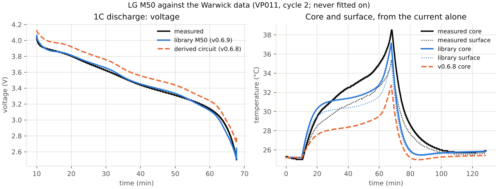

# Validation against measured cell temperatures

**Bottom line:**
- **Thermal model:** with one calibrated parameter, it predicts the measured surface temperature of a commercial 18650 cell within **0.60 K median RMSE** over 48 blind tests (a 49th test is used for the calibration), from 25 °C down to −20 °C. That covers drive cycles, constant-current discharge and CC-CV charging.
- **Fully predictive model** (current in, voltage and temperature out): **0.65 K median RMSE** for temperature over the same 48 blind tests, with 88 % within 1 K and every ambient's median at or below 0.77 K. Voltage error is **17–34 mV** from 25 °C to 0 °C and 53–70 mV at −10 and −20 °C (v0.4.10; it was 84–177 mV).
- **LG M50** (the default design cell): no measured data is used. Its circuit is derived from a physics model, and its heat agrees with that model within −6 % to +13 % ([below](#lg-m50-checked-against-a-physics-model-not-measured)).

## Data

- **Dataset:** P. Kollmeyer, *Panasonic 18650PF Li-ion Battery Data*, Mendeley Data v1 (2018), doi:10.17632/wykht8y7tg.1, **CC BY 4.0**. A new 2.9 Ah Panasonic NCR18650PF (NCA/graphite) was tested in a thermal chamber at 25, 10, 0, −10 and −20 °C, with a thermocouple on the case at mid-height.
- **Same cell as the thesis:** the NCR18650PF is the cell the original MSc thesis calibrated its 3C heat load against.
- **Processed subset:** 49 tests are stored in `validation/data/panasonic_18650pf/` (3.3 MB, attribution in its README), made by `validation/prepare_panasonic.py`:
  - all 41 single drive cycles (US06, HWFET, UDDS, LA92, NN, mixed cycles 1–4);
  - two 1C discharges;
  - one 1C CC-CV charge.

## Method

| Step | Uses | Gives |
|---|---|---|
| OCV | 25 °C C/20 discharge (+ its I·R) | `src/packtherm/data/ncr18650pf_ocv.csv` |
| Kinetics | every HPPC pulse at all 5 temperatures (`validation/identify_panasonic.py`) | R0, Butler–Volmer charge transfer I₀(T) with Eₐ = 45 kJ/mol, low-SOC factor. 10 s overpotential within a median 5–11 % at every temperature |
| Cold laws (v0.4.10) | the 0.9 A discharge-and-rest steps between HPPC pulse sets at 25, 10, 0, −10 °C (`cold_laws`; the −20 °C file is incomplete) | low-SOC rise Eₐ = 20.7 kJ/mol; slow branch Eₐ = 26.8 kJ/mol (re-running the script gives 20.6 and 27.1) |
| Thermal calibration | **one test**: 25 °C 1C discharge #1, temperature | chamber h = 38.7 W/m²K |
| Slow polarisation | the same test, voltage | R_d = 28.4 mΩ, τ_d = 405 s |
| **Validation** | the other **48 tests, blind** | below |

Two modes are reported for every test:
- **Thermal:** heat = I·(OCV − V_measured). Only the thermal model is under test.
- **Predictive:** only the current goes in. The equivalent-circuit model predicts voltage and heat; temperature feeds back into resistance every step. For the CC-CV charge, only the charge *request* (1C) goes in, so the model has to produce the CV taper itself.

Other details:
- Records that begin with a long soak (cooling down after a charge) are trimmed to start 60 s before the current.
- Starting SOC comes from the rested voltage.
- The ambient is taken from the chamber channel only where it agrees with the setpoint; the channel reads a constant 0.0 in the −10 °C files.

## Results

| Ambient | Tests | Thermal mode: median RMSE / worst peak error | Predictive: median RMSE / worst peak error | Predictive voltage RMSE (median, before end-of-discharge knee) |
|---|---|---|---|---|
| 25 °C | 12 | 0.53 K / 1.1 K | 0.45 K / 1.4 K | 17 mV |
| 10 °C | 9 | 0.67 K / 0.9 K | 0.60 K / 1.6 K | 22 mV |
| 0 °C | 9 | 0.56 K / 0.7 K | 0.77 K / 2.0 K | 34 mV |
| −10 °C | 9 | 0.59 K / 0.5 K | 0.70 K / 3.1 K | 53 mV |
| −20 °C | 9 | 0.72 K / 1.2 K | 0.73 K / 3.5 K | 70 mV |


v0.4.10 compared with v0.4.9 (same 48 blind tests): predictive tests within 1 K 79 % → 88 %; −20 °C median 1.28 → 0.73 K; cold voltage error roughly halved. The worst cold peak errors changed sign: the model used to over-predict heat in the cold (+3.4 K worst, the safe side for design) and now under-predicts it slightly (−3.5 K worst, cold heat 7–10 % low on average).

The measured rises go up to 20 K in the cold. 96 % of thermal-mode tests and 88 % of predictive tests are within 1 K RMSE. Full per-test table: [`validation/summary.csv`](validation/summary.csv).


## What the validation does and doesn't show

- **Shown:**
  - The radial conduction and energy balance, and the jelly-roll heat capacity estimated from O'Regan 2022 layer data, reproduce a real cell's transient response across a 45 K range of ambient temperatures and 0–7C dynamic loads.
  - The electrical model reproduces voltage and self-heating from 25 °C down to 0 °C.
  - The CC-CV logic tracks the measured current taper.
- **Calibrated, not predicted:** h is a property of *this chamber*, not of the cell. In a design study h is the design variable, so calibrating it here is appropriate.
- **Known gaps:**
  - **Deep cold (v0.4.10):** the low-SOC rise now grows in the cold, so the voltage knee arrives earlier (the cold capacity loss), and the slow branch follows its own Arrhenius law. Both laws come from identification data, not the validation tests. In the cold the predictive model now under-predicts heat by 7–10 % on average (worst peak −3.5 K at −20 °C): a slow-branch law fitted at 0.3C is a little too gentle for drive-cycle currents. Following the charge-transfer kinetics instead over-predicts by a similar amount, so the true behaviour sits between the two.
  - **Cold capacity loss** is now modelled through that low-SOC rise; voltage error is still reported before the knee for comparability.
  - **Entropic heat** is still neglected for this NCA cell (no dU/dT data in the dataset). The charge is about 1.1–1.4 K under-predicted in both modes, consistent with missing reversible heat. Published NCA/graphite profiles disagree on the sign over the relevant SOC range (one study reports entropic heat strongly negative on charge, which would make the error worse), so no literature curve is applied; a potentiometric measurement on this cell would settle it.
  - **Single cell, thermocouple on the surface:** core temperature is not validated on this cell. The model's in-cell gradient is up to about 2.8 K at 2C (25 °C). Since v0.6.9 the core is checked on the LG M50 against a thermocouple inside the cell ([below](#lg-m50-measured-v069)).

## LG M50: measured (v0.6.9)

Data: Gulsoy, Kucuk, Barai and Marco (University of Warwick), "Dataset of internal temperature during lithium-ion battery ageing", Mendeley Data v2, doi:10.17632/bf6fksxpp2.2, CC BY 4.0. LG INR21700-M50 cells in a 25 °C chamber, three with a thermocouple in the core as well as on the surface. Three parts are used, all prepared into `validation/data/` (the raw MATLAB files are not stored here):

- **Pulses** (`prepare_m50_rpt.py`): each of six cells' first characterisation run, fresh: 2C (10 A) and C/2 pulses of 30 s at about 100, 80, 50 and 20 % charge.
- **1C discharges with the core measured** (`prepare_m50_core.py`): cycles 2 and 3 of the three instrumented cells and cycle 2 of a plain one, each with the 10 minutes before, the rest after and the first hour of the next charge.
- **Drive cycles** (`prepare_m50_drive.py`): three cells' 8 h from full, in 1 s steps (logged at up to 1 kHz).

**The resistance was half the cell's.** The derived circuit (below) drops 130–200 mV on a 2C pulse where the cells drop 270–400 mV; its open-circuit voltage is within about 10–50 mV. One scale on every loss term, fitted on the 2C pulses at 30 % charge and above (`fit_m50_scale.py`), is **2.04**, and the library M50 has carried it since v0.6.9 (the v0.6.8 circuit is `M50-DERIVED`):

| Pulses (six cells) | n | Derived circuit (v0.6.8) | Scaled ×2.04 (v0.6.9) |
|---|---|---|---|
| 2C, 30 % and above (fitted) | 18 | 167 mV RMS | 18 mV |
| 2C, about 20 % (check) | 6 | 147 mV | 55 mV |
| C/2, all levels (check) | 24 | 39 mV | 13 mV |

Near empty the scaled circuit drops too much: there the cells drop 1.7 times what the derived circuit does, not 2 times.

**Then the 1C discharges, never fitted on** (`check_m50_core.py`). The chamber's h is calibrated on one test's surface (VP010, cycle 2: 43.8 W/(m² K)); everything else is a check. "Measured heat" puts the heat from the measured voltage into the thermal model alone; "predicted" makes voltage and heat from the current:

| 1C discharge, 7 tests | Surface RMS | Core RMS | Core − surface at the end | Voltage RMS |
|---|---|---|---|---|
| Measured heat, library conductivity (1.2 W/(m K)) | 0.6–1.1 K | 0.6–1.2 K | 1.7–2.0 K (measured 2.3–3.5) | |
| Predicted, library M50 (v0.6.9) | 0.8–0.9 K | 0.7–1.4 K | 1.7–1.9 K | 18–40 mV |
| Predicted, derived circuit (v0.6.8) | 1.1–2.2 K | 2.2–3.2 K | 1.1–1.2 K | 114–146 mV |
| Measured heat, a tenth of the conductivity (0.12) | 0.4–1.0 K | 5.8–7.1 K | 14–16 K | |



- **The heat was about 60 % of the real cell's** with the derived circuit: its surface rose 5.7–6.4 K where the cells rose 8–10.4 K. Scaled, the model rises 9.2–10.2 K.
- **The core runs 2–3.5 K above the surface** at the end of a 1C discharge; the model has 1.7–2 K with the library's radial conductivity. A tenth of it (0.12 W/(m K), which the 30T and HG2 fits allowed) gives 14–16 K and is ruled out: the effective value is nearer 0.6–1 W/(m K). That settles BACKLOG item 5 for these cells: the 30T and HG2's low fitted values stood in for something else (the fixture, or the case thermocouple's lag).
- **Not yet right:** the measured heat comes later in the discharge than the model's (the model's core is about 1 K warm in the first third and 1–2 K cool in the middle), and the cells cool more slowly afterwards than the model. Both point at heat the model doesn't have in the right place (entropic heat near empty, or the cell holder's heat capacity).
- **Drive cycles, never fitted on** (`check_m50_drive.py`, three cells, 8 h each of drive cycles up to 7.2 A with regen, CC-CV top-ups and rests, from full to about 16 % charge): **34–36 mV RMS** while current flows (the derived circuit: 44 mV). Most of what is left is the open-circuit curve, taken from the M50T's published table: at the end of long rests the circuit sits 15–35 mV below the cells. The file's temperatures carry no clock shared with its current, so these runs check the voltage only (the cells rise only a few kelvin).
- **25 °C only.** The scale is checked at 25 °C; the circuit's temperature dependence is still the physics model's. The plain cell (VP016) rises 8.5 K and two of the instrumented cells about 10 K at the same current: the thermocouple in the core changes the cell a little.

- **The lumped M50 (`M50-LUMPED`, the datasheet's 30 mΩ) made about half the heat** (v0.6.9): its surface rose 5.5–5.9 K on the 1C discharges against 8–10.4 K measured. Lumped models of the other library cells made 22–64 % of their circuits' heat on a steady discharge, so the lumped and derived variants are listed apart, for comparison only. **Since v0.6.11** the lumped model carries slow losses tuned on the PF, 30T and HG2 circuits (`validation/tune_lumped_slow.py`, never on the M50): the lumped M50 rises 8.0–8.4 K, surface RMS 0.8–1.1 K (was 1.0–2.1), core 0.9–1.7 K (was 2.0–3.0). It is still low on the hottest three cells (10.1–10.4 K) and right on the others (8.0–8.5 K).

Results: [`validation/m50_pulse_scale.json`](../validation/m50_pulse_scale.json), [`validation/m50_core_check.json`](../validation/m50_core_check.json), [`validation/m50_drive_check.json`](../validation/m50_drive_check.json).

## LG M50: checked against a physics model, not measured

*Before v0.6.9. The measured pulses above showed this circuit's resistance at half the real cell's; the library M50 now carries it scaled ×2.04.*


The LG M50 is the cell the design studies use, but there is no open temperature dataset for it that this build can reach. Since v0.4.11 its equivalent circuit is **derived**: PyBaMM's DFN model with the ORegan2022 parameter set (measured on the LG M50T, with temperature dependence) is run through synthetic pulse tests at 25, 10, 0 and −10 °C, and the same circuit as the PF cell is fitted to them (`validation/derive_m50_ecm.py`).

`validation/check_m50_ecm.py` then compares irreversible heat with the DFN (self-heating) on 0.5C, 1C and 1.4C discharges and a pulsed profile at 25, 10 and 0 °C, driving both packtherm models along the DFN's temperature path:

| Model | Heat ÷ DFN, all 12 cases | Pulsed profile |
|---|---|---|
| Derived circuit (`LG_M50_ECM`, the default since v0.4.11) | 0.94–1.13 | 0.98–1.06 |
| Old lumped resistance (`LG_M50_LUMPED`) | 0.92–1.42 | 1.24–1.42 |

The derived circuit stays within 6 % except at 25 °C 0.5C (+13 %), where the heat is smallest. The lumped model over-predicts pulsed heat by up to 42 % because it has no slow branch that relaxes between pulses. Full table: [`validation/m50_vs_dfn.csv`](../validation/m50_vs_dfn.csv).


This checks the circuit against the model it was derived from, so it shows the fit is faithful, not that the DFN is right about a real M50. The circuit also stops at its voltage cut-off, which in the cold comes later than the DFN's (up to 0.75 Ah later at 0 °C, 1.4C).

## Reproduce

```bash
python validation/run_panasonic.py           # validation table + figures
python validation/run_panasonic.py --recalibrate
pytest tests/test_validation.py              # regression gates on these claims
# from the raw dataset (not stored here):
python validation/prepare_panasonic.py  /path/to/Panasonic-18650PF-Data
python validation/identify_panasonic.py /path/to/Panasonic-18650PF-Data   # kinetics, then the cold laws
# LG M50 (needs pip install pybamm):
python validation/derive_m50_ecm.py
python validation/check_m50_ecm.py           # writes validation/m50_vs_dfn.csv
python docs/figures/make_m50_check.py
# LG M50 measured (v0.6.9; preparing needs the Warwick files, mat-io for the core tests and about 6 GB):
python validation/prepare_m50_core.py /path/to/100cycles_dataTable.mat
python validation/prepare_m50_rpt.py  /path/to/ShortTerm_RPT_dataTable.mat
python validation/prepare_m50_drive.py /path/to/LoadProfile_dataTable.mat   # needs h5py
python validation/check_m50_drive.py --json validation/m50_drive_check.json
python validation/tune_lumped_slow.py --json validation/lumped_slow.json     # v0.6.11, about 20 min
python validation/fit_m50_scale.py --json validation/m50_pulse_scale.json
python validation/check_m50_core.py --json validation/m50_core_check.json   # rounded when committed
python docs/figures/make_m50_measured.py
pytest tests/test_m50_measured.py
```
